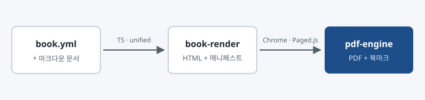

# 소개

MDX Editor는 마크다운과 MDX 문서를 편집하고, HTML과 PDF로 미리보고 내보내는 데스크톱 편집기입니다. 이 문서는 MDX Editor의 샘플 문서이자, 지원하는 문법과 PDF 출력 기능을 보여주는 예제입니다.

{width=90%}

## 이 문서의 구성

이 예제는 `book.yml` 파일 하나와 문서 네 개로 이루어져 있습니다.

| 파일 | 내용 |
| --- | --- |
| `book.yml` | 문서 제목, 버전, 언어와 문서 순서를 정의합니다. |
| `introduction.md` | 지금 읽고 있는 소개 문서입니다. |
| `writing.md` | 마크다운으로 문서를 작성하는 방법을 설명합니다. |
| `components.mdx` | `.mdx` 문서에서 컴포넌트를 쓰는 방법을 설명합니다. |
| `export.md` | 템플릿을 골라 PDF로 내보내는 방법을 설명합니다. |

## 주요 기능

- 폴더를 열고 파일별로 문서를 편집합니다.
- 여러 문서를 `book.yml`로 묶어 하나의 책으로 관리합니다.
- 커버, 목차, 본문, 백 커버로 구성된 PDF를 출력합니다.
- PDF에는 북마크와 목차 링크가 포함됩니다.

:::info

이 문서를 직접 PDF로 출력해 보려면 [PDF로 내보내기](#pdf로-내보내기) 장을 참고하세요.

:::
