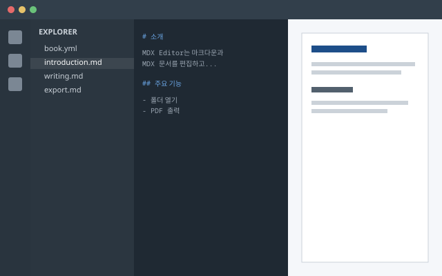

# 문서 작성하기

`.md` 문서는 일반적인 마크다운 문법에 몇 가지 확장 문법을 더해 작성합니다. 이 장의 내용은 모두 실제로 렌더링된 결과입니다.

## 기본 문법

제목은 `#`의 개수로 단계를 나눕니다. 목차와 PDF 북마크에는 템플릿에 설정된 단계(기본값은 1, 2단계)의 제목이 표시됩니다.

**굵게**, *기울임*, ~취소선~, `인라인 코드`, [링크](https://github.com/suprema-kjim/mdxEditor)를 사용할 수 있습니다.

```markdown
**굵게**, *기울임*, ~취소선~, `인라인 코드`, [링크](https://github.com/suprema-kjim/mdxEditor)
```

강조 표식 바로 뒤에 조사가 붙어도 됩니다. 예: **설정(Settings)**을 누르고 **“저장”**을 선택합니다.

1. 번호 목록은 숫자와 마침표로 시작합니다.
1. 목록 안에 다른 요소를 넣으려면 들여쓰기합니다.

    > 목록 안에 들어간 인용문입니다.

1. 목록 항목은 쪽 중간에서 나뉘지 않습니다.

## 이미지

이미지 뒤에 중괄호로 속성을 붙이면 크기와 클래스를 지정할 수 있습니다.

```markdown [이미지 속성 예]
{.border width=60%}
{.btn}
```

{.border width=60%}

`.btn` 클래스를 붙이면 아이콘을 글자 사이에 넣을 수 있습니다. 예를 들어 {.btn} 버튼을 클릭하라고 안내할 때 씁니다.

## 안내 상자

`:::종류`로 시작하고 `:::`로 끝나는 블록은 안내 상자로 표시됩니다. 안내 상자는 `Callout` 컴포넌트로 그려지므로 `.mdx` 문서의 `<Callout>`과 모양이 같습니다.

| 종류 | 쓰임 |
| --- | --- |
| `:::info` | 참고 정보 |
| `:::tip` | 알아 두면 편한 요령 |
| `:::note` | 덧붙이는 설명 |
| `:::caution` | 주의가 필요한 내용 |
| `:::warning` | 데이터 손실처럼 꼭 피해야 하는 위험 |

:::info

참고 정보는 `:::info` 상자에 적습니다.

:::

:::tip

`:::tip` 상자에는 작업을 더 쉽게 하는 요령을 적습니다.

:::

:::note

`:::note` 상자에는 본문에 덧붙이는 설명을 적습니다.

:::

:::caution

주의가 필요한 내용은 `:::caution` 상자에 적습니다.

:::

:::warning

꼭 피해야 하는 위험은 `:::warning` 상자에 적습니다.

:::

## 표

표는 GFM 표 문법으로 씁니다. 둘째 줄의 `:`로 칸 정렬(왼쪽 `:---`, 가운데 `:---:`, 오른쪽 `---:`)을 정합니다.

| 항목 | 설명 | 기본값 |
| :--- | :--- | ---: |
| `title` | 문서 제목 | 없음 |
| `lang` | 문서 언어 코드 | en-US |

### 칸 합치기

칸에 `>`만 쓰면 오른쪽 칸과 합치고, `^`만 쓰면 위 칸과 합칩니다. `.md`와 `.mdx` 문서 모두에서 쓸 수 있습니다.

```markdown [칸 합치기]
| 구분 | 1분기 | 2분기 | 3분기 |
| --- | --- | --- | --- |
| 매출 | > | 1,200 | 1,500 |
| 비용 | 400 | 450 | 500 |
| ^ | > | 예산 안 | 예산 초과 |
```

| 구분 | 1분기 | 2분기 | 3분기 |
| --- | --- | --- | --- |
| 매출 | > | 1,200 | 1,500 |
| 비용 | 400 | 450 | 500 |
| ^ | > | 예산 안 | 예산 초과 |

- `매출` 행의 `>`는 오른쪽 칸 `1,200`과 합쳐져 1분기와 2분기에 걸칩니다.
- `^`는 위 칸 `비용`과 합쳐져 두 행에 걸칩니다.
- 합칠 칸은 `>`나 `^` 한 글자만 있어야 합니다. 다른 글이 함께 있으면 보통 칸으로 그립니다.

## 코드 블록

코드 블록의 언어 뒤에 대괄호로 제목을 붙이면 코드 블록 위에 제목이 표시됩니다.

```yaml [book.yml]
title: MDX Editor
subtitle: 사용자 가이드
version: 0.1.0
lang: ko-KR
documents:
  - introduction.md
  - writing.md
  - components.mdx
  - export.md
```

## 쪽 나누기

원하는 위치에서 쪽을 나누려면 다음 HTML을 넣습니다. 각 장의 첫 제목(`#`)은 템플릿 설정에 따라 항상 새 쪽에서 시작합니다.

```html
<div class="page-break"></div>
```

`.mdx` 문서에서는 내장 컴포넌트 `<PageBreak />`를 씁니다. 자세한 내용은 [컴포넌트 사용하기](#컴포넌트-사용하기) 장을 참고하세요.
